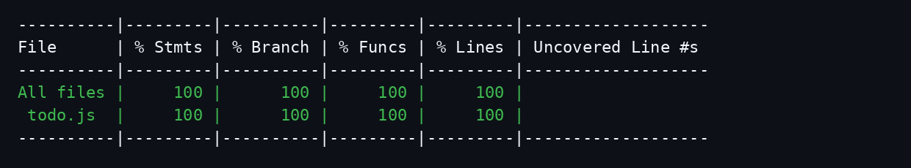

# Todo-модуль на Jest

Капстоун-проект: модуль управления задачами, разработанный по TDD и покрытый unit-тестами на Jest 30.

## Возможности

- создание, добавление, удаление, поиск и переключение задач;
- подсчёт активных задач и формирование сводки;
- асинхронная загрузка задач через внешний API;
- автосохранение с настраиваемой задержкой;
- бонусные функции `filterActive` и `renameTask`.

Основные функции не мутируют исходные задачи и массивы.

## Технологии

JavaScript (ES-модули), Jest 30, Babel, GitHub Actions.

## Запуск

```bash
npm ci
npm test
npm run test:coverage
```

## Тестирование

В `src/todo.test.js` применены:

- `toEqual`, `toBe`, `toThrow` и другие матчеры;
- параметризованные тесты `test.each`;
- проверки иммутабельности;
- моки зависимостей через `jest.fn()`;
- асинхронные тесты с `mockResolvedValue`, `mockRejectedValue` и `rejects.toThrow`;
- виртуальное время с `useFakeTimers` и `advanceTimersByTime`;
- снимок через `toMatchSnapshot`.

Сеть и реальные таймеры в тестах не используются. Порог покрытия — 90% по всем метрикам, фактическое покрытие — 100%.

## Покрытие



## CI

GitHub Actions устанавливает зависимости и запускает тесты с проверкой покрытия для каждого push и pull request. Конфигурация находится в `.github/workflows/ci.yml`.
